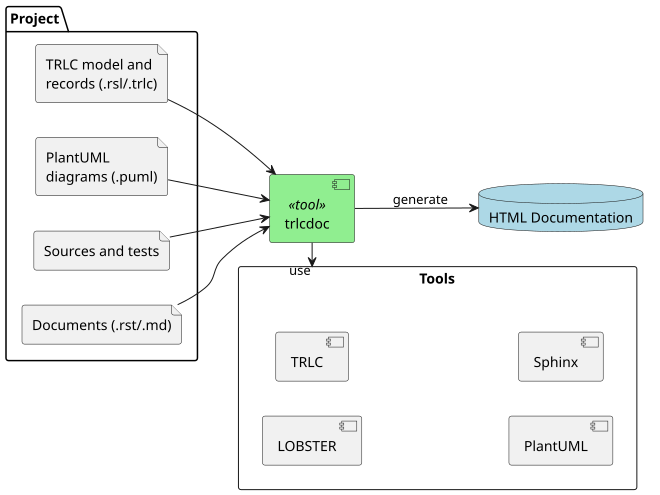

# trlcdoc

Configurable documentation tooling for TRLC based projects.

trlcdoc converts [TRLC](https://github.com/bmw-software-engineering/trlc)
requirements, test results and [LOBSTER](https://github.com/bmw-software-engineering/lobster)
trace reports into a static project documentation web site. A `trlcdoc.yaml`
configuration file in the project root defines what to process.



Status: prototype. The configuration may change incompatibly before 1.0.

- **Documentation:** <https://nhjschulz.github.io/trlc-doc/>
- **Source code:** <https://github.com/nhjschulz/trlc-doc>

## Installation

```bash
pip install trlcdoc
```

The HTML site needs a Java runtime for PlantUML, and Graphviz for all
diagrams except sequence diagrams.

## Usage

```bash
trlcdoc                             # all steps, uses ./trlcdoc.yaml (or a parent folder)
trlcdoc tests trace                 # selected steps only
trlcdoc clean all                   # fresh full build
trlcdoc -c other.yaml check         # validate a configuration
```

A minimal `trlcdoc.yaml` that converts one folder of TRLC requirements into an
HTML site in `build/trlcdoc/html`:

```yaml
project:
  name: example
  author: Jane Doe
  copyright: "2026, Jane Doe"

paths:
  trlc_model: trlc/model

documents:
  - id: sw_requirements
    title: SW Requirements
    type: trlc
    source: trlc/swe-req
    pytrlcconverter:
      converter:
        rst: builtin:req2rst.py
```

## Configuration schema

Editors with YAML language support validate the configuration against the
published JSON schema. Use the copy matching your trlcdoc release, here for
version 0.3.0:

```yaml
# yaml-language-server: $schema=https://nhjschulz.github.io/trlc-doc/schema/V0.3.0/trlcdoc.schema.json
```

The [configuration reference](https://nhjschulz.github.io/trlc-doc/configuration.html)
explains every section and key.

## License

GPL-3.0-or-later
