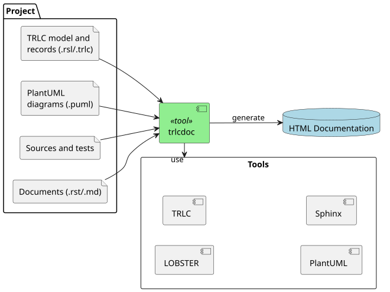

# trlcdoc

[](https://github.com/nhjschulz/trlc-doc/blob/main/LICENSE)
[](https://pypi.org/project/trlcdoc/)
[](https://github.com/nhjschulz/trlc-doc/actions/workflows/test.yml)
[](https://nhjschulz.github.io/trlc-doc/)
[](https://www.repostatus.org/#wip)

Configurable documentation tooling for TRLC based projects.

The trlcdoc tool is a tailored utility for converting TRLC files,
test results and LOBSTER trace reports into a static project report
website. It is driven by a configuration YAML file that defines
the project specific content to process.



**NOTE**:
trlcdoc is not a standalone solution, but a component extending the
[trlc](https://github.com/bmw-software-engineering/trlc)
and
[BMW LOBSTER tooling](https://github.com/bmw-software-engineering/lobster)
with automated documentation generation.
An understanding of their purpose and usage is required to benefit from trlcdoc.

**Status**: alpha. The configuration may change incompatibly before 1.0.0.

## Goals

The trlcdoc tool was created to simplify the documentation
generation for development projects that follow an *everything
as code* approach. Its focus is not on end-user documentation,
but on information for the development team, such as requirements, architecture,
test results and traces between them.

The trlcdoc tool aims for the following goals:

* **Portability**: Replace host system dependent scripting that
  is difficult to maintain and gets duplicated into new projects
  over and over again (bat files, bash scripts, make, ...).

* **Configurability**: Tool operation is driven by a single configuration
  file in YAML format, which makes it easy to apply it to new projects.

* **Correctness**: Analyze results of each execution step, report errors
  and stop before producing incomplete or broken results.

* **Quality**: The development of trlcdoc follows best practices from the
  V-Model. It is driven by requirements, has a documented architecture and
  high unit test code coverage. In addition, its own project documentation is
  built by itself following the "eating your own dog food" practice.

## Principle of Operation

trlcdoc provides a fixed set of steps to generate the documentation. All
steps are configured by sections in a YAML configuration file. The steps to
execute are given to trlcdoc as arguments. Without arguments, or with `all`,
trlcdoc executes all steps except `clean`.

The table below shows the supported steps. Steps always execute in this order:

| Step | Does |
|---|---|
| `clean` | Removes the output folder with all build artifacts, including the downloaded PlantUML jar. Not part of `all`. |
| `check` | Validates the configuration against the schema and checks all references. |
| `plantuml` | Uses `$PLANTUML`, a configured jar, or downloads the configured PlantUML version. |
| `tests` | Runs pytest (or a command), converts the JUnit XML into TRLC test result records. |
| `convert` | Converts each TRLC document with its pyTRLCConverter converter. |
| `trace` | Generates the lobster-trlc configs and the LOBSTER policy from `trace.levels`, creates the HTML tracing report. |
| `html` | Generates the Sphinx sources from `documents` and builds the site. |

Exit codes: `0` success, `1` content findings (failed tests, missing trace
links), `2` build error. All generated files go to `paths.output`
(default `build/trlcdoc`), never into this package folder.

## Usage

### Installation

The HTML site generation needs a Java runtime for PlantUML, and Graphviz for all
diagrams except sequence diagrams.

**From PyPI:**

```bash
pip install trlcdoc
trlcdoc --help
```

**As a submodule:**

```bash
# Create a python venv (recommended)
python3 -m venv .venv
. .venv/bin/activate

# add trlcdoc to your project as a submodule
git submodule add https://github.com/nhjschulz/trlc-doc tools/trlc-doc
pip install -e tools/trlc-doc       # the submodule folder

trlcdoc --help
```

### Execution Examples

```bash
trlcdoc                             # all steps, uses ./trlcdoc.yaml (or a parent folder)
trlcdoc tests trace                 # selected steps only
trlcdoc clean                       # remove all build artifacts
trlcdoc clean all                   # fresh full build
trlcdoc convert --format markdown   # Markdown export of the TRLC documents
trlcdoc trace --online              # tracing report linked to the repository
trlcdoc -c other.yaml check         # validate a configuration
```

## Configuration

The project configuration `trlcdoc.yaml` lives in the project root. See
[configuration.md](configuration.md) which explains every section and key with
examples. The schema of the configuration
is [trlcdoc/schema/trlcdoc.schema.json](trlcdoc/schema/trlcdoc.schema.json);
editors with YAML language support validate against it with this first line:

```yaml
# yaml-language-server: $schema=tools/trlc-doc/trlcdoc/schema/trlcdoc.schema.json
```

Without the submodule, use the published schema of your trlcdoc release
(one copy per tag `Vx.y.z`):

```yaml
# yaml-language-server: $schema=https://nhjschulz.github.io/trlc-doc/schema/V0.3.0/trlcdoc.schema.json
```

Users of Visual Studio Code can use the
[redhat.vscode-yaml](https://marketplace.visualstudio.com/items?itemName=redhat.vscode-yaml)
extension to get schema validation for `trlcdoc.yaml` files.

See trlcdoc's own [trlcdoc.yaml](./trlcdoc.yaml) configuration as a full example.

Key concepts:

- **documents** are the pages of the site, in table of contents order. Their
  `id` is the key used everywhere else. Types: `trlc`, `test_results`,
  `trace_report`, `html`, `rst`, `markdown`, `text`, `command`.
- **pytrlcconverter** holds the pyTRLCConverter options of a `trlc` or
  `test_results` document: the project `converter` per output format, the
  `translation` and the render configuration `render_cfg`.
  `builtin:<file>` refers to [trlcdoc/converters](trlcdoc/converters), any other
  path is relative to the project root.
- **include** lists the documents whose TRLC files are needed to resolve
  references, e.g. the requirements for the architecture.
- **trace.levels** are the LOBSTER levels. Each TRLC level names its `document`;
  the lobster-trlc inputs are derived from it and its includes.
- **tests.link** maps test results to TRLC test cases: the JUnit `property`
  if the test records one, otherwise the `output` pattern in the test output
  (e.g. Unity `TEST_MESSAGE` lines of Ceedling tests), otherwise the
  `from` -> `to` name pattern. A test recording several test cases needs
  `array: true` and a model with `relates SwTestCase [1 .. *]`. The result
  records are written into the package of the linked test cases.
- **html** customizes the site: `theme`, `extensions`, `extra_conf`, a project
  start page `index` (it owns the toctree; TRLC documents are named
  `<id>/index`), a `page_header` for every generated page, and a project Sphinx
  configuration file `conf`, executed at the end of trlcdoc's
  [conf.py](trlcdoc/sphinx/conf.py) with `PROJECT_ROOT` and `trlcdoc_links` set. In these files and in `rst`/`markdown` documents,
  `{project_root}` is replaced by the relative path from the page to the
  project root.
- A TRLC or test result document without `title` takes its page title from the
  converted content.
- **PLANTUML** environment variable: a plantuml.jar or a PlantUML server URL.

The built-in TRLC converters are the project converters of
[pyTRLCConverter](https://github.com/NewTec-GmbH/pyTRLCConverter) (`tools/converter`),
for its 3.x API. pyTRLCConverter also determines the trlc version.

## Trlcdoc Documentation

The trlcdoc project documentation is itself being generated using trlcdoc.
The latest version is available online at
[https://nhjschulz.github.io/trlc-doc/](https://nhjschulz.github.io/trlc-doc/).

Run the following commands to build it locally:

```bash
# setup virtual environment and install trlcdoc

python3 -m venv .venv
. .venv/bin/activate
pip install -e ".[test,doc]"

# generate documentation
trlcdoc -c trlcdoc.yaml
```

The website is written to `build/trlcdoc/html`.

## Code Tracing

Every function of the [trlcdoc](trlcdoc) package traces to the software
requirements it implements with a comment before its docstring:

```python
def find_config(start: Path) -> Path:
    # lobster-trace: SwRequirements.sw_req_config_file
    """Find the default configuration file trlcdoc.yaml in a folder or its parents.
```

The trace level `SW Code` in [trlcdoc.yaml](trlcdoc.yaml) extracts the comments with
[lobster-python](https://pypi.org/project/bmw-lobster-tool-python/).
A function without comment is reported as a finding by the trace step, and so is a
requirement without an implementing function.

Note: Support for code tracing to other languages like C/C++ or Rust is currently
under development.

## Tests

The pytest unit tests in [tests](tests) verify the software requirements. Each
test function `test_<name>` implements the TRLC test case `tc_<name>` in
[trlc/swe-test](trlc/swe-test), which links it to its requirements. Most tests
run trlcdoc on a minimal example project, created in a temporary folder.

```bash
pip install -e ".[test]"
pytest
```

The HTML site tests need a Java runtime for PlantUML. They use the jar from
`$PLANTUML`, or download it once into the pytest cache. The
[Tests workflow](.github/workflows/test.yml) runs the tests on every push and
pull request on Linux and Windows.

## License

GPL-3.0-or-later, see [LICENSE](LICENSE).